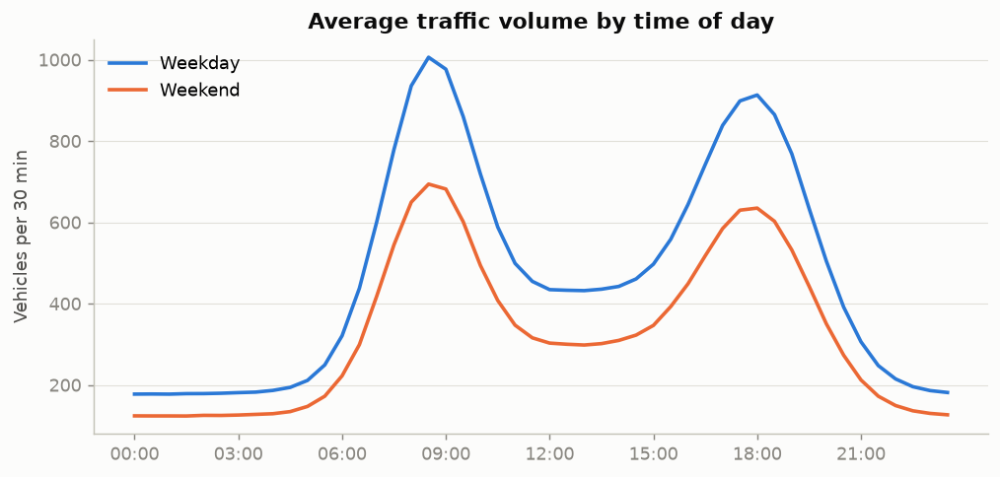
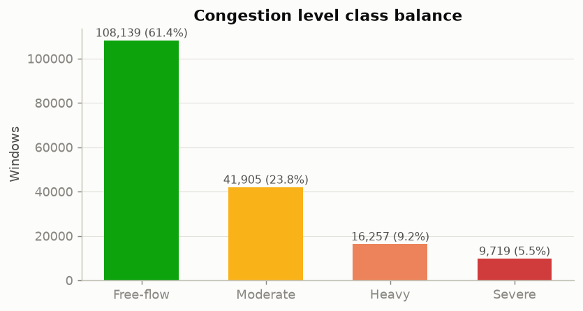
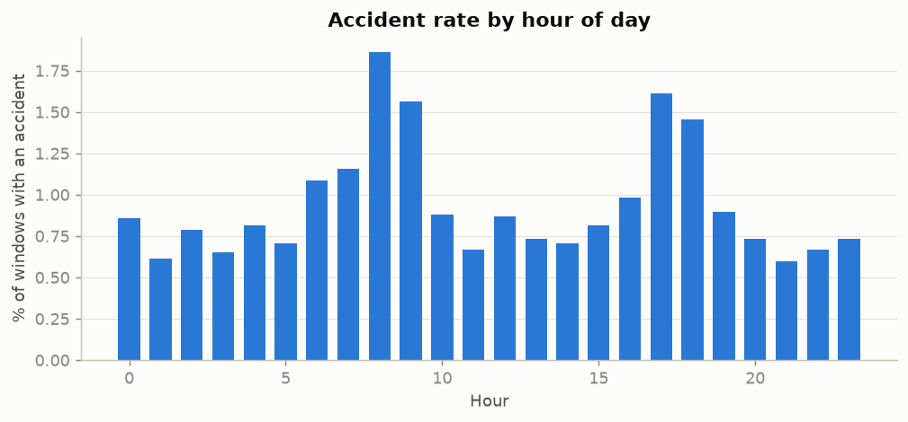
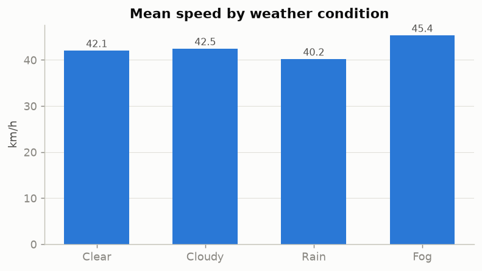
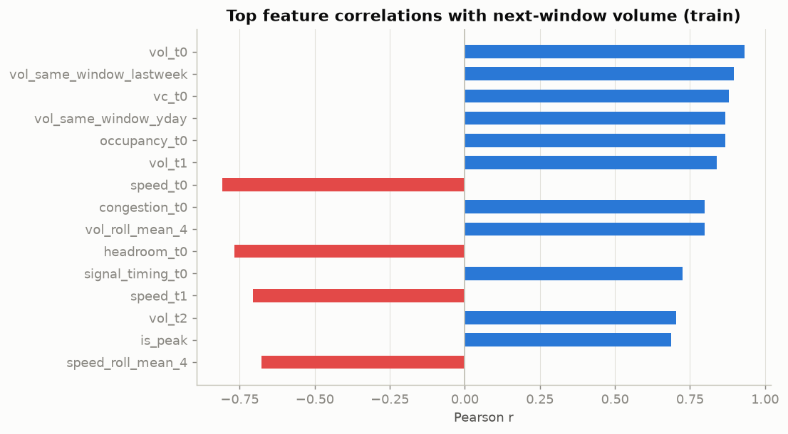
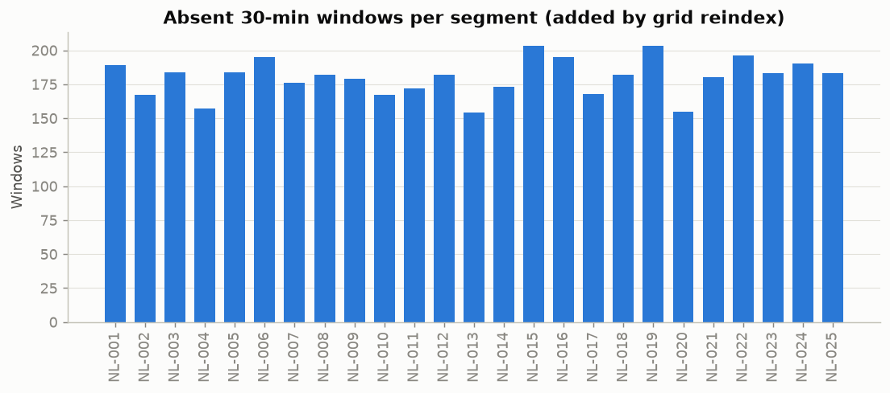

# FlowCast — Data-Quality Report

**Data source:** raw files in raw/

Generated by `src/eda.py` from the cleaning log. Every rule that touched the data is listed with
its count. Bad rows are quarantined in `data/interim/quarantine.csv`; nothing is dropped silently.

## 1. Cleaning log

| Stage | Rule | Count | Action | Note |
| --- | --- | ---: | --- | --- |
| M1 ingest | calendar rows loaded | 151 | kept | 0 bad dates, 0 duplicate dates quarantined |
| M1 ingest | weather rows loaded | 10,872 | kept | 0 quarantined; 0 negative rainfall, 0 impossible visibility set to NaN |
| M1 ingest | traffic rows read | 178,468 | loaded |  |
| M2 dedup | exact duplicate rows | 1,767 | removed (quarantined) |  |
| M2 dedup | key duplicates (road_id+date+time) | 1,767 | removed (quarantined) | kept the most complete record per key |
| M2 outliers | traffic_volume < 0 | 239 | set to NaN, then imputed |  |
| M2 outliers | avg_speed > 200 km/h | 236 | set to NaN, then imputed |  |
| M2 outliers | occupancy > 100 % | 229 | set to NaN, then imputed |  |
| M2 outliers | traffic_volume |z| > 4.0 (segment x window) | 9 | flagged only |  |
| M2 outliers | avg_speed |z| > 4.0 (segment x window) | 52 | flagged only |  |
| M2 outliers | occupancy |z| > 4.0 (segment x window) | 30 | flagged only |  |
| M2 JSON | vehicle_type_dist unparseable | 0 | shares set to NaN, then imputed |  |
| M2 grid | absent windows added by reindex | 4,499 | row added, values imputed | 25 segments x 7248 windows = 181,200 rows |
| M2 impute | vehicle_count == traffic_volume | 172,114 | checked | equal in 100.00% of rows -> vehicle_count is the target, never a same-window feature |
| M2 impute | traffic_volume repaired from vehicle_count | 4,587 | filled |  |
| M2 impute | traffic_volume short gaps (<= 2 windows) | 4,498 | time interpolation within segment |  |
| M2 impute | traffic_volume long gaps / edges | 1 | segment x time-window median (train dates only) |  |
| M2 impute | avg_speed short gaps (<= 2 windows) | 9,024 | time interpolation within segment |  |
| M2 impute | avg_speed long gaps / edges | 54 | segment x time-window median (train dates only) |  |
| M2 impute | occupancy short gaps (<= 2 windows) | 9,018 | time interpolation within segment |  |
| M2 impute | occupancy long gaps / edges | 54 | segment x time-window median (train dates only) |  |
| M2 impute | travel_time short gaps (<= 2 windows) | 4,498 | time interpolation within segment |  |
| M2 impute | travel_time long gaps / edges | 1 | segment x time-window median (train dates only) |  |
| M2 impute | signal_timing short gaps (<= 2 windows) | 4,498 | time interpolation within segment |  |
| M2 impute | signal_timing long gaps / edges | 1 | segment x time-window median (train dates only) |  |
| M2 impute | share_2w short gaps (<= 2 windows) | 4,498 | time interpolation within segment |  |
| M2 impute | share_2w long gaps / edges | 1 | segment x time-window median (train dates only) |  |
| M2 impute | share_car short gaps (<= 2 windows) | 4,498 | time interpolation within segment |  |
| M2 impute | share_car long gaps / edges | 1 | segment x time-window median (train dates only) |  |
| M2 impute | share_lcv short gaps (<= 2 windows) | 4,498 | time interpolation within segment |  |
| M2 impute | share_lcv long gaps / edges | 1 | segment x time-window median (train dates only) |  |
| M2 impute | share_hcv short gaps (<= 2 windows) | 4,498 | time interpolation within segment |  |
| M2 impute | share_hcv long gaps / edges | 1 | segment x time-window median (train dates only) |  |
| M2 congestion | V/C rule reproduces existing labels | 146,171 | checked | agreement 100.00% -> congestion is a function of same-window volume (leakage risk) |
| M2 congestion | blank congestion_level (observed volume) | 25,943 | derived from V/C |  |
| M2 congestion | blank congestion_level (imputed volume) | 5,180 | derived from V/C, excluded from evaluation |  |
| M2 weather | labels normalised (13 raw spellings) | 10,872 | strip + lowercase + map to Clear/Cloudy/Rain/Fog |  |
| M2 weather | 'Overcast' (not in documented vocabulary) | 358 | mapped to Cloudy |  |
| M2 weather | unrecognised weather labels | 0 | forward-filled from previous hour |  |
| M2 weather | duplicate station-hours | 0 | removed |  |
| M2 weather | missing station-hours | 0 | row added, forward-filled | 3 stations x 3624 hours = 10,872 |
| M2 weather | weather_condition missing | 0 | forward-filled within station |  |
| M2 weather | temperature missing | 167 | forward-filled within station |  |
| M2 weather | rainfall missing | 0 | forward-filled within station |  |
| M2 weather | visibility missing | 111 | forward-filled within station |  |
| M2 merge | rows after weather + calendar join | 181,200 | kept | 0 rows without weather |
| M2 output | quarantine file rows | 2,471 | written to data/interim/quarantine.csv |  |

## 2. Final table

- Rows: 181,200 (= 25 segments x 7,248 windows)
- Rows that existed in the raw file: 176,701; added by reindex: 4,499
- Volume source: observed 172,114, repaired_from_count 4,587, interpolated 4,498, median 1
- Congestion source: original 150,077, derived_observed_volume 25,943, derived_imputed_volume 5,180
- Split (by date): train 120,000, test 31,200, val 30,000

## 3. Decisions to defend in review

- **Dedup first.** Duplicates are removed on road_id + date + time before any other step, keeping the most complete record.
- **Full grid before lags.** Every segment is reindexed to 48 windows x 151 days, so a lag of 1 always means the previous 30 minutes.
- **Faults -> NaN -> impute.** Negative volume, speed > 200 km/h and occupancy > 100 % are physically impossible and treated as missing.
- **Repair from vehicle_count.** vehicle_count equals traffic_volume in ~99.9 % of rows, so missing/faulty volume is repaired from it. Repaired rows are still excluded from test metrics.
- **Imputation.** Gaps of <= 2 windows use time interpolation within the segment; longer gaps use the segment x time-window median computed on training dates only.
- **Interpolation vs leakage (PRD conflict).** PRD §9.1 asks for time interpolation, but an interpolated value at t uses the value at t+1. Lag features are therefore built from a causal fill (forward fill <= 2 windows, then the train median). The interpolated column is used only for EDA and the dashboard.
- **'Overcast'** is not in the documented vocabulary and is mapped to Cloudy.
- **Congestion is derived from volume.** The V/C rule reproduces the existing labels almost exactly, so the same window's volume/V/C/occupancy/speed are never model inputs for that window.

## 4. Descriptive statistics (observed values)

| column         |   count |   mean |   median |    std |   min |     max |
|:---------------|--------:|-------:|---------:|-------:|------:|--------:|
| traffic_volume |  176701 | 431.45 |   362    | 283.56 |  41   | 2090    |
| avg_speed      |  172122 |  42.11 |    44.9  |  11.39 |   6.7 |   64.8  |
| occupancy      |  172128 |  31.16 |    27    |  19.62 |   3   |  100    |
| travel_time    |  176701 |   3.57 |     3.12 |   2.53 |   0.8 |   29.91 |

## 5. Weather vs traffic

| weather_condition   |   windows |   mean_speed_kmh |   mean_volume |   accident_rate_pct |
|:--------------------|----------:|-----------------:|--------------:|--------------------:|
| Clear               |    132715 |            42.07 |        437.42 |                0.83 |
| Cloudy              |     35779 |            42.49 |        429.01 |                0.75 |
| Rain                |      6959 |            40.24 |        368.17 |                3.46 |
| Fog                 |      1248 |            45.38 |        218.44 |                3.53 |

## 6. Strongest feature correlations with next-window volume (train)

|                          |   pearson_r |
|:-------------------------|------------:|
| vol_t0                   |       0.932 |
| vol_same_window_lastweek |       0.896 |
| vc_t0                    |       0.879 |
| vol_same_window_yday     |       0.867 |
| occupancy_t0             |       0.867 |
| vol_t1                   |       0.839 |
| speed_t0                 |      -0.807 |
| congestion_t0            |       0.798 |
| vol_roll_mean_4          |       0.798 |
| headroom_t0              |      -0.768 |

## 7. Figures

